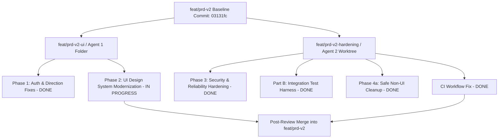

# Khidmat (خدمت) v2.0.0 — Master Project Status & Verification Report

**Prepared Jointly on Behalf of:**
- **Agent 1 (UI & UX Modernization Agent)** — Working in `khidmat_app-main` on branch `feat/prd-v2-ui`
- **Agent 2 (Reliability, Security & Hardening Agent)** — Working in `khidmat-hardening` on branch `feat/prd-v2-hardening`

**Date:** November 24, 2026  
**Status:** **PHASE 0, 1, 3, 4a COMPLETE** | **PHASE 2 IN PROGRESS** | **PHASE 4b, 5 SKIPPED** | **PHASE 6 READY FOR RELEASE PREP**

---

## 1. Executive Summary & Architecture

Khidmat (خدمت) is an on-demand, bilingual (Urdu & English) home services mobile marketplace designed specifically for the Pakistani market (Lahore, Karachi, Islamabad/Rawalpindi). The platform connects consumers with vetted service providers (electricians, plumbers, AC technicians, appliance repairers, cleaning staff).

### Technical Stack Topology
- **Client Application:** React Native (Expo SDK 57, New Architecture enabled, React 19, Expo Router v5, NativeWind Tailwind CSS, Moti animations, TanStack Query v5).
- **Backend & Database:** Supabase Cloud (PostgreSQL 15, Row Level Security, Realtime Broadcast Channels, Edge Functions, Storage Buckets).
- **Self-Healing Agent Server:** Express / Node 20 / LangChain / Gemini 2.5 Flash for autonomous error triage, telemetry, and natural language search.
- **Continuous Integration:** GitHub Actions (`.github/workflows/ci.yml`) enforcing secret scanning, static typing, linting, and automated unit test suites.

---

## 2. Multi-Agent Worktree Division of Labor

To accelerate delivery without workspace collisions or git merge conflicts, work was isolated into two parallel tracks:



### Strict Ownership Boundaries
| Domain | Agent 1 (UI Agent) Owns | Agent 2 (Hardening Agent) Owns |
| :--- | :--- | :--- |
| **Files** | `app/**`, `src/components/**`, `src/theme/**`, `src/features/**`, `src/i18n/**` | `supabase/**`, `agent-server/**`, `src/services/**`, `src/types/**`, `src/utils/privacy.ts`, `eas.json`, `.github/**`, `scripts/**`, `docs/SECURITY.md`, `docs/reports/**` |
| **Branch** | `feat/prd-v2-ui` | `feat/prd-v2-hardening` |
| **Location** | `D:\dev-stuff\khidmat_app-main` | `D:\dev-stuff\khidmat-hardening` |

---

## 3. Agent 1 (UI & UX Agent) — Work Completed & In Progress

### ✅ Completed Tasks (Phase 0 & Phase 1)
1. **P1-1 (OAuth Redirect & Complete Profile):**
   - Implemented browser-based Google OAuth redirect with PKCE flow.
   - Built `src/utils/authUrlParser.ts` for deep links (`khidmat://auth/callback`).
   - Created `app/auth/complete-profile.tsx` for newly onboarded social users without role/city.
2. **P1-2 (Bilingual Layout Direction & Phone Isolation):**
   - Created single source of truth `src/i18n/direction.ts` for dynamic RTL flipping.
   - Preserved strict LTR formatting for Pakistani phone numbers so `+92 300 1234567` never flips to `92+ 300...` in Urdu mode.
   - Replaced hardcoded physical CSS with logical alignment tokens (`text-start`, `self-start`).
3. **P1-3 (Status Bar Contrast & Android Autofill Sanitization):**
   - Fixed status bar styling (`<StatusBar style="dark" />` on light cream `#FBFAF6` backgrounds).
   - Sanitized input fields in `app/(auth)/auth.tsx` with `importantForAutofill="no"` to eliminate yellow Android autofill background clashes.
4. **P1-4 (Dev/Test Gating for Demo Login):**
   - Gated the 1-Tap Quick Demo Login button behind `EXPO_PUBLIC_ENABLE_DEMO=true` via `src/utils/demoAuth.ts`. Production release builds strictly omit test credentials.

### 🔄 In Progress (Phase 2 — UI Modernization)
- Updating design tokens (palette, spacing, typography) with Noto Nastaliq Urdu font pairing.
- Modernizing bottom-sheet filters for service discovery and provider ratings.
- Polishing customer and provider dashboard interactions.

---

## 4. Agent 2 (Hardening & Security Agent) — Work Completed

### ✅ Completed Tasks (Phase 3 — Hardening)
1. **P3-1 (Mock Fallback Removal):**
   - Removed silent in-memory fallback in `src/services/supabase/client.ts`. Production configurations missing Supabase keys now return a handled `ConfigError` proxy rather than silently serving fake data.
   - Relocated mock client to `src/test-utils/mockClient.ts`.
   - Updated `AuthContext.tsx` to trap `ConfigError` and notify user/UI.
2. **P3-2 (Secrets & Config Sanitization):**
   - Stripped sensitive keys from `eas.json` — retaining only the public `anon` key.
   - Authored automated secret detection script `scripts/secret-scan.js` detecting private keys and non-anon JWTs.
   - Integrated secret scanner directly into GitHub Actions CI.
3. **P3-3 (KYC Privacy & Storage Hardening):**
   - Authored database migration `0013_kyc_and_security_hardening.sql`:
     - Configured `kyc-documents` bucket as private (`public = false`).
     - Restricted upload and read permissions strictly to document owners and authorized admins.
     - Mandated time-limited Signed URLs for document inspection.
     - Added cascading KYC document cleanup to `delete_user_account()`.
   - Built `maskCnic()` in `src/utils/privacy.ts` (e.g., `42101-*******-1`) with comprehensive unit tests.
4. **P3-4 (RLS & Anti-Tampering Hardening):**
   - Authored database migration `0014_rls_hardening.sql`:
     - `trg_prevent_role_escalation`: Database trigger blocking users from self-promoting to `admin`.
     - `trg_prevent_price_tampering`: Database trigger locking `estimated_price` and `total_price` once booking is accepted.
     - `trg_admin_actions_immutable`: Database trigger enforcing an append-only audit log.
   - Documented complete Table × Role × Operation RLS matrix in `docs/SECURITY.md`.
5. **P3-5 (Typed Error Normalization & Telemetry):**
   - Standardized typed errors in `src/services/errors.ts` (`ServiceError`, `NetworkError`, `AuthRequiredError`, `PermissionDeniedError`, `NotFoundError`, `ValidationError`).
   - Integrated error wrappers into `queries.ts` and `agentClient.ts` with automated reporting to `errorReporter.ts`.
6. **P3-6 (Autonomous Agent Server Hardening):**
   - Built JWT validation middleware with expiration and audience checks (`SUPABASE_JWT_AUDIENCE`).
   - Enforced Zod schema validation on `/api/recommend` and crash diagnostic endpoints.
   - Added IP-based sliding-window rate limiting (60 requests/min).
   - Restricted CORS strictly to configured client origins (`ALLOWED_ORIGINS`).
   - Added `/health` and `/api/health` probes and documented all 16 server env vars in `API.md`.

### ✅ Completed Tasks (Part B — Integration Test Harness)
- Built `src/services/supabase/__tests__/integration/`: Test user fixtures, authentication helpers, and automated teardown.
- Implemented safety guard: Aborts with exit code 1 if targeting production URL or non-test instance without `SUPABASE_TEST_CONFIRM=yes`.
- Authored test suites:
  - `rls.integration.test.ts` (RLS-01 to RLS-04)
  - `stateMachine.integration.test.ts` (SM-01 to SM-03, including concurrent booking accept race test)
  - `lifecycle.integration.test.ts` (DEL-01 KYC cascade, REP-01 user report moderation, PUSH-01 notification dispatch)
- Created dedicated runner `scripts/test-integration.js` and `jest.integration.config.js`.
- Status: **NOT RUN** (4 suites / 19 tests safely skipped until owner provisions test credentials in `.env.test`).

### ✅ Completed Tasks (Phase 4a — Safe Repo Cleanup)
- `P4-1`: Deleted dead directories `archive/`, `scratch/`, and `docs/archive/`.
- `P4-2`: Deleted duplicate legacy script `supabase/complete_setup.sql`.
- `P4-3`: Evaluated `legacy.ts`. Preserved safely because 9 UI screens still import it.
- `P4-6`: Untracked 28 legacy PNG screenshots from `docs/qa-artifacts/` and added to `.gitignore`. Retained machine-readable `qa-results.json`.
- `P4-7`: Consolidated all scattered QA/analysis reports into `docs/reports/` and created master index `docs/README.md`.
- `P4-8`: Relocated test runners `scripts/e2e-qa-suite.mjs` and `scripts/test-chrome.mjs` to `e2e/`.
- `P4-9`: Authored `docker/README.md` documenting compose stack and local vs. cloud test tradeoffs.
- `P4-12`: Regenerated `src/types/database.types.ts` reflecting all 14 migrations with zero TypeScript type drift.

### ✅ Completed Tasks (CI Workflow Fix)
- Resolved GitHub Actions workflow failure (`.github/workflows/ci.yml: No jobs were run`).
- Replaced invalid job-level `env` conditional with valid secret expression `${{ secrets.SUPABASE_TEST_URL != '' }}` and upgraded actions to `@v4`. Committed and pushed in `9a941cf`.

---

## 5. Phase 4b & Phase 5 Status (Per Owner Directive)

Per the owner's request:
- **Phase 4b (UI-Adjacent Cleanup):** Tasks `P4-4`, `P4-5`, `P4-10`, `P4-11` (retiring `legacy.ts`, pruning deprecated UI components, unused icon sets, and dead style tokens) are deferred until Agent 1 completes Phase 2 and both branches merge.
- **Phase 5 (Cloud Integration Tests Execution):** Live execution against `khidmat-test` is paused until the owner provisions the Supabase test project. The test runner is ready and waiting.

---

## 6. Phase 6: Release Readiness & Play Store Launch Audit

A thorough audit against `docs/LAUNCH_CHECKLIST.md` reveals the following readiness posture:

### Current Launch Checklist
```
[x] P0: Database Migrations 0001 -> 0014 authored & verified
[x] P0: In-Memory Mock Fallback removed (Safe ConfigError proxy in place)
[x] P0: In-App Account Deletion & GDPR Data Anonymization (0011 + 0013)
[x] P0: RLS Security Matrix & Anti-Role Escalation Triggers (0014)
[x] P0: Private KYC Documents Storage with Signed URLs (0013)
[x] P0: Automated CI Secret Scanning active
[x] P1: User Reporting & Content Moderation Console (0012)
[x] P1: Low-Overhead Realtime GPS Tracking Channels
[x] P1: Atomic Booking State Machine with Server-Side Guard Triggers
[x] P1: Agent Server Rate-Limiting & JWT Authentication
[ ] P0 (Owner): Apply migrations 0001-0014 to production Supabase database
[ ] P0 (Owner): Configure Google OAuth Client ID & Redirect URL in Supabase Dashboard
[ ] P0 (Owner): Play Console Data Safety Form & Privacy Policy URL submission
[ ] P0 (Owner): App Icon & Splash Screen final assets review
[ ] P1 (Owner): Setup Expo Push Token dispatcher credentials in Supabase
[ ] P1 (Owner): Bootstrap initial production admin account (`role = 'admin'`)
```

---

## 7. Master Quality Gates & Diagnostic Verification Table

All diagnostics have been executed locally in `D:\dev-stuff\khidmat-hardening` and verified:

| Diagnostic Check | Tool / Command | Exit Code | Result | Details |
| :--- | :--- | :---: | :---: | :--- |
| **Static Typing** | `npm run typecheck` (`tsc --noEmit`) | `0` | **PASS** | 0 errors across client and server |
| **Linting** | `npm run lint` (`eslint .`) | `0` | **PASS** | 0 errors across entire workspace |
| **Unit Tests** | `npm test` (`jest --coverage`) | `0` | **PASS** | 18 suites passed, 80 tests passed, 0 failures |
| **Agent Server Tests**| `npm test` in `agent-server` | `0` | **PASS** | 11 tests passed, 0 failures |
| **Secret Scan** | `node scripts/secret-scan.js` | `0` | **PASS** | 176 tracked files scanned, 0 secrets detected |
| **Expo Doctor** | `npx expo-doctor` | `0` | **PASS** | 21/21 environment and dependency checks passed |
| **Cloud Integration**| `node scripts/test-integration.js` | `0` | **NOT RUN** | 4 suites / 19 tests safely skipped (no keys) |
| **Git Working Tree** | `git status` | `0` | **CLEAN** | Working tree clean on `feat/prd-v2-hardening` |

---

## 8. Database Migrations Ledger (Complete Schema: 0001 → 0014)

| Migration | Purpose | Status |
| :--- | :--- | :--- |
| `0001_init.sql` | Core schema: profiles, services, bookings, reviews | Frozen |
| `0002_legacy_compatibility.sql` | Backwards compatibility views and legacy columns | Frozen |
| `0003_storage_buckets.sql` | Setup avatars, service images, and proof attachments | Frozen |
| `0004_realtime_setup.sql` | Realtime publication configuration | Frozen |
| `0005_fix_storage_and_reviews.sql` | Storage RLS rules and review constraint fixes | Frozen |
| `0006_provider_profiles.sql` | Provider vetting flags, hourly rates, and skills | Frozen |
| `0007_admin_console.sql` | Admin role helper and verification queue queries | Frozen |
| `0008_realtime_tracking.sql` | Live GPS location broadcast channels | Frozen |
| `0009_booking_state_machine.sql` | Atomic booking status transition guards | Frozen |
| `0010_notifications.sql` | In-app alerts and notifications table | Frozen |
| `0011_account_deletion.sql` | Self-serve account deletion & data anonymization | Frozen |
| `0012_user_reports.sql` | Moderation queue and user reporting system | Frozen |
| `0013_kyc_and_security_hardening.sql` | Private KYC bucket, signed URLs, cascading deletion | **New (Agent 2)** |
| `0014_rls_hardening.sql` | Anti-escalation, accepted price lock, audit immutability | **New (Agent 2)** |

---

## 9. Action Items & Instructions for the Owner

To finalize the release, the owner needs to perform the following sequential steps:

1. **Monitor GitHub Actions CI Run:**
   - Check the Actions tab on `Muhammad08-dot/khidmat_app-main`.
   - Verify that commit `9a941cf` completes with green checkmarks.
2. **Apply Database Migrations to Live Supabase:**
   ```bash
   npx supabase link --project-ref <your-supabase-project-id>
   npx supabase db push
   ```
   *(This cleanly executes migrations `0001` through `0014` on your production Supabase database).*
3. **Configure Google OAuth in Supabase:**
   - In Supabase Dashboard $\rightarrow$ **Authentication** $\rightarrow$ **URL Configuration**:
     - Site URL: `khidmat://auth/callback`
     - Redirect URLs: Add `khidmat://*` and `khidmat://auth/callback`
   - In Supabase Dashboard $\rightarrow$ **Authentication** $\rightarrow$ **Providers** $\rightarrow$ **Google**:
     - Enable Google and enter your Google Cloud OAuth Client ID & Secret.
4. **Bootstrap First Admin:**
   - In Supabase SQL Editor:
     ```sql
     UPDATE public.profiles SET role = 'admin' WHERE email = 'your-admin-email@khidmat.app';
     ```
5. **(Optional) Run Integration Tests on Cloud Test Instance:**
   - Create Supabase project `khidmat-test`.
   - Create `.env.test` in root directory with `SUPABASE_TEST_URL`, `SUPABASE_TEST_ANON_KEY`, `SUPABASE_TEST_SERVICE_ROLE_KEY`, and `SUPABASE_TEST_CONFIRM=yes`.
   - Run `node scripts/test-integration.js` to execute the 19 live cloud integration tests.
6. **Merge Branches when Agent 1 Finishes Phase 2:**
   - Once Agent 1 completes the UI redesign, merge `feat/prd-v2-hardening` and `feat/prd-v2-ui` into `feat/prd-v2`.
